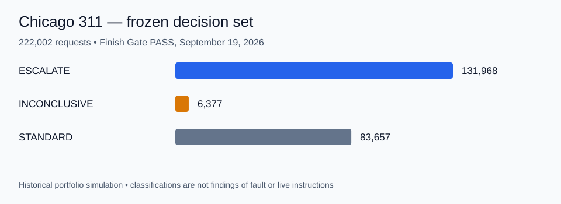

# Chicago 311 Dispatch Priority

**AI-Augmented operational prioritization using the City of Chicago 311 Service Requests dataset**

Chicago 311 Dispatch Priority is **Dataset 2 of 3** in a portfolio evaluation of the five-stage **AI-Augmented Analyst** methodology.

The project tests whether the same decision-first workflow used in FulfillIQ 2.0 can control a much larger operational dataset with request-level triage, time-window logic, ambiguous operational warrant, and a three-way action decision.

## Executive result

**Completed methodology simulation. Finish Gate PASS: September 19, 2026.** This is not a live City dispatch system.

The frozen rules classify **222,002 requests** from a source snapshot containing **14,635,395 rows**:

| Classification | Requests |
|---|---:|
| ESCALATE | 131,968 |
| INCONCLUSIVE | 6,377 |
| STANDARD | 83,657 |
| Total decision set | 222,002 |



**Decision:** accept the frozen labels as a methodology result. Return to Framing to define an attention budget and ranking before producing any operational focus list. Approximately 59% of the decision set is ESCALATE; a validated classification alone does not establish a workable shift plan.

[Finish Gate receipt](docs/stage-05-interpretation/FINISH_GATE_RECEIPT.md) · [Decision interpretation](docs/stage-05-interpretation/FINISH_GATE_PACKAGE.md) · [Reconciliation evidence](validation/reconciliation/EXACT_RECON_REPORT.md)

## What validation caught

The first production comparison found **104 label disagreements** caused by a roughly five-hour timezone-parsing difference. After repair against the locked contract, both independent R paths agreed on all **222,002** labels, with **14/14 fixtures passing on each path**. Agreement demonstrates implementation consistency on the frozen pack; it does not prove causal neglect, official SLA breaches, or live dispatch priority.

## My contribution and AI roles

I own the portfolio project and its human gate approvals. AI builders and reviewers support design, implementation, and critique; their reports and the owner approval are preserved in the evidence records. My responsibility is to assess the question, validation evidence, limitations, and proportionate next action.

## Five-stage method

1. **Start**
2. **Framing**
3. **Measurement Design**
4. **Execution, Independent Validation, and Analysis**
5. **Interpretation and Recommendation**

The reusable methodology is documented separately in [`ai-augmented-analyst-workflow`](https://github.com/markjamesc/ai-augmented-analyst-workflow).

This project also adds a **deterministic R workflow gate** between the completed Stage 4 validation chain and Stage 5. The gate does not redo the analysis. It verifies that the required five-stage procedure was actually followed on the correct locked design and fixture versions, with preserved evidence and no unresolved validation failure.

## Locked project decision

The project is limited to one decision:

> **Among open eligible 311 requests in a frozen decision window, which requests should receive `ESCALATE`, `INCONCLUSIVE`, or `STANDARD` dispatch priority?**

The final judged universe must contain one row per request. The result is a **portfolio simulation**, not a live City of Chicago dispatch system.

## Data source

Primary source: **City of Chicago 311 Service Requests**  
Dataset ID: `v6vf-nfxy`

Local MySQL schema and authoritative raw table:

```text
schema: chicago311
table:  raw_311_requests
```

### Raw import verification completed

The frozen source snapshot has been imported and checked.

```text
Physical rows:             14,635,395
Columns:                            39
Distinct SR_NUMBER:        14,635,395
Duplicate SR_NUMBER:                0
```

Observed `STATUS` values:

```text
Completed              14,177,547
Open                      245,193
Canceled                  212,654
Closed                          1
Total                  14,635,395
```

Date and missingness checks:

```text
CREATED_DATE range: 2018-07-01 03:42:31 to 2026-09-12 15:39:45
Missing CREATED_DATE:                  0
Unparseable CREATED_DATE:              0
Missing LAST_MODIFIED_DATE:            0
Missing SR_TYPE:                       0
Missing STATUS:                        0
Missing CLOSED_DATE:             245,217
```

The missing `CLOSED_DATE` count is characterized source behavior, not automatically an error.

**Raw Source Gate status: PASS.**

## Canonical Stage 4 + workflow-gate architecture

```text
LOCKED STAGE 3
      |
      v
CONTROLLED SQL SOURCE
thin, faithful, nonjudgmental
      |
      v
SQL SOURCE GATE
      |
   -----------
   |         |
   v         v
  R-A       R-B
independent judged paths
   |         |
   -----+-----
        |
        v
EXACT RECONCILIATION
        |
        v
STRUCTURAL CROSS-REVIEW
        |
        v
VALIDATED DATA FREEZE
        |
        v
R WORKFLOW GATE
procedural enforcement
        |
   PASS | FAIL
        |   └──> return for repair
        v
STAGE 5
```

SQL is used for controlled source delivery and verification. Stage 3 freezes analytical meaning before implementation. R-A and R-B independently construct the judged analytical result from the same verified source package.

The separate workflow-gate R script then verifies that the required procedural receipts, design-version continuity, fixture-version continuity, validation passes, and declared evidence artifacts are present before Stage 5 may begin.

## Source-delivery guardrail

The authoritative raw table contains more than 14.6 million rows. Stage 4 should not blindly deliver the full table to R.

The framing and measurement process must establish:

- **decision feasibility** — the proposed question must be materially answerable from available source fields; and
- **delivery feasibility** — Stage 3 must define the smallest faithful SQL source-delivery envelope that preserves everything needed for the decision without embedding judged analytical logic upstream.

SQL should not pre-decide `is_in_window`, `is_open`, `is_eligible`, analytical deduplication, urgency, action, selection, or final membership unless Stage 3 explicitly authorizes a strictly mechanical step.

## Deterministic workflow enforcement

The project-level gate is:

`validation/workflow-gate/workflow_gate.R`

Run it from the repository root with:

```bash
Rscript validation/workflow-gate/workflow_gate.R .
```

It checks machine-readable receipts created after Stages 1–4 pass. Stage 5 is allowed only when the generated `workflow_gate_status.json` reports `PASS` and `stage5_allowed = true`.

This enforcement layer verifies **procedure**, not substantive truth. It does not replace the three-AI reviews, Stage 4 analytical reconciliation, or human judgment.

## Repository map

```text
chicago-311-dispatch-priority/
├── README.md
├── COPYRIGHT.md
├── docs/
│   ├── source-manifest.md
│   ├── dataset-eval-context.md
│   ├── warrant-ledger.md
│   ├── orchestration/
│   │   ├── master-orchestration-prompt.md
│   │   ├── controlling-framework-manifest.md
│   │   └── grokbot-conversation-transcript.md
│   ├── stage-01-02-start-framing/
│   │   ├── stage1_decision.example.json
│   │   └── stage2_framing.example.json
│   ├── stage-03-measurement-design/
│   │   └── stage3_locked_design.example.json
│   ├── stage-04-execution-validation/
│   │   └── stage4_validation_status.example.json
│   └── stage-05-interpretation/
├── sql/source-delivery/
├── R/r-a/
├── R/r-b/
├── validation/source-gate/
├── validation/fixtures/
├── validation/reconciliation/
├── validation/cross-review/
├── validation/workflow-gate/
│   ├── workflow_gate.R
│   └── README.md
├── outputs/
└── data-documentation/
```

The raw 311 CSV is not committed to this repository.

## Status

**Completed frozen methodology simulation; Finish Gate PASS on September 19, 2026. Operational focus-list design remains a separate Framing task.**

Historical stage packages and receipts retain their original wording and timestamps. The final Finish Gate receipt governs the completion status. Later prospective framework upgrades do not retrofit this frozen run.

The master orchestration prompt is the controlling project prompt and is preserved at:

`docs/orchestration/master-orchestration-prompt.md`

## Copyright

Copyright © 2026 Mark Ciganovic. All rights reserved. See [`COPYRIGHT.md`](COPYRIGHT.md).
